# WIX1002 Fundamentals of Programming
## Tutorial 1: Problem Solving in Programming

Each problem has an IPO model, pseudocode and a flowchart.

---

# Part I

## 1. Multiply two numbers

| Input | Process | Output |
|---|---|---|
| num1, num2 | product = num1 * num2 | product |

```text
START
  PRINT "Enter first number"
  READ num1
  PRINT "Enter second number"
  READ num2
  product = num1 * num2
  PRINT product
END
```

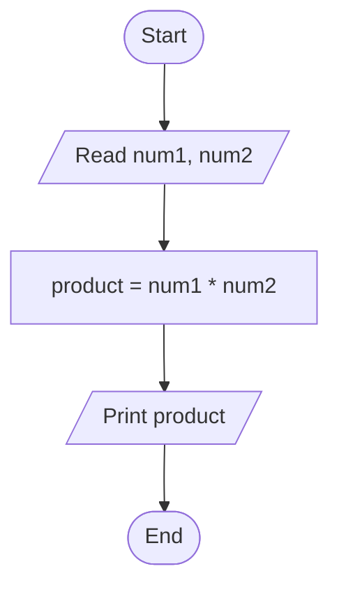

---

## 2. Is a random number greater than 50?

| Input | Process | Output |
|---|---|---|
| None (number generated by computer) | Generate random number; compare with 50 | "Greater than 50" or "Not greater than 50" |

```text
START
  num = random number
  PRINT num
  IF num > 50 THEN
    PRINT "Greater than 50"
  ELSE
    PRINT "Not greater than 50"
  ENDIF
END
```

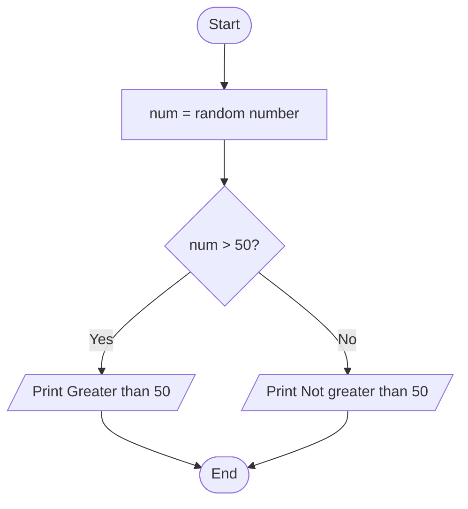

---

## 3. Pass/fail grade (pass mark is at least 40)

| Input | Process | Output |
|---|---|---|
| mark | Check whether mark >= 40 | "Pass" or "Fail" |

```text
START
  READ mark
  IF mark >= 40 THEN
    PRINT "Pass"
  ELSE
    PRINT "Fail"
  ENDIF
END
```

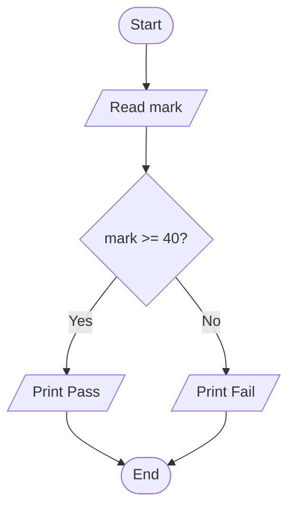

---

## 4. Two-player dice game

Each player rolls one die (1 to 6). The higher roll wins; equal rolls are a draw.

| Input | Process | Output |
|---|---|---|
| None (dice rolled by computer) | Roll die for player 1 and player 2 (random 1-6); compare the values | Both dice values and the result (Player 1 wins / Player 2 wins / Draw) |

```text
START
  dice1 = random number from 1 to 6
  dice2 = random number from 1 to 6
  PRINT "Player 1: ", dice1
  PRINT "Player 2: ", dice2
  IF dice1 > dice2 THEN
    PRINT "Player 1 wins"
  ELSE IF dice2 > dice1 THEN
    PRINT "Player 2 wins"
  ELSE
    PRINT "Draw"
  ENDIF
END
```

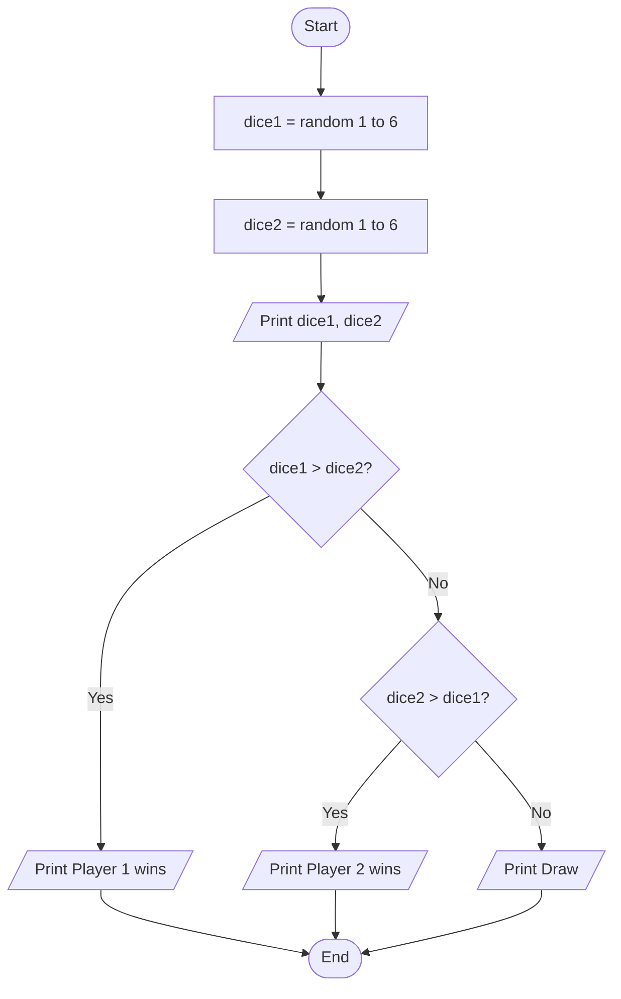

---

## 5. Perimeter of a rectangle

| Input | Process | Output |
|---|---|---|
| length, width | perimeter = 2 * (length + width) | perimeter |

```text
START
  READ length
  READ width
  perimeter = 2 * (length + width)
  PRINT perimeter
END
```

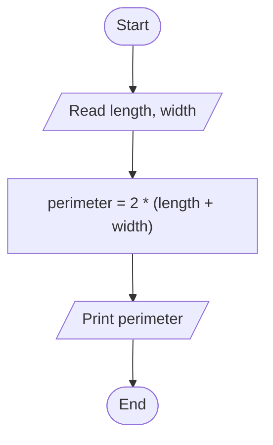

---

## 6. Minimum of 10 random numbers

| Input | Process | Output |
|---|---|---|
| None (10 random numbers generated by computer) | Generate each number; keep the smallest seen so far | min |

```text
START
  num = random number
  min = num
  count = 1
  WHILE count < 10
    num = random number
    IF num < min THEN
      min = num
    ENDIF
    count = count + 1
  ENDWHILE
  PRINT min
END
```

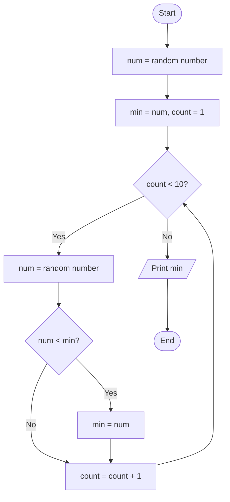

---

## 7. Count odd and even numbers from 10 random numbers (range 10 - 100)

| Input | Process | Output |
|---|---|---|
| None (10 random numbers from 10 to 100) | Generate each number; if num % 2 = 0 add 1 to even, otherwise add 1 to odd | oddCount, evenCount |

```text
START
  oddCount = 0
  evenCount = 0
  count = 0
  WHILE count < 10
    num = random number from 10 to 100
    IF num MOD 2 = 0 THEN
      evenCount = evenCount + 1
    ELSE
      oddCount = oddCount + 1
    ENDIF
    count = count + 1
  ENDWHILE
  PRINT oddCount, evenCount
END
```

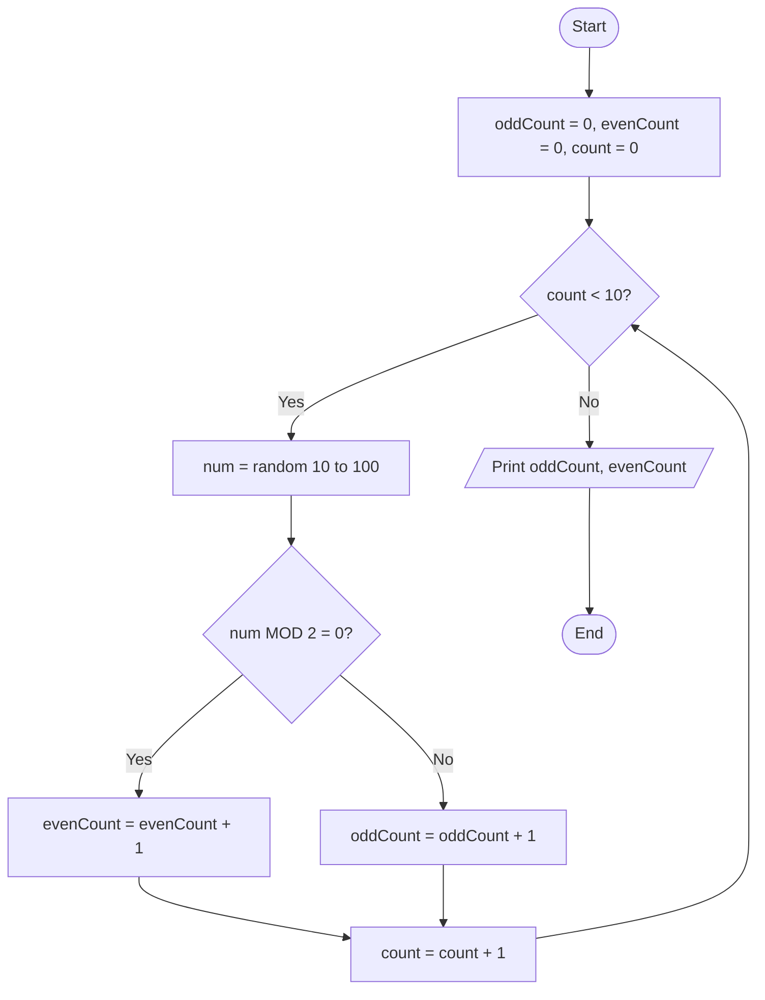

---

# Part II

## 8. Count the letters U and M in a sentence

Case-insensitive: both `U`/`u` and `M`/`m` are counted.

| Input | Process | Output |
|---|---|---|
| sentence | Convert to uppercase; check each character; count U and M | countU, countM |

```text
START
  READ sentence
  sentence = UPPERCASE(sentence)
  countU = 0
  countM = 0
  FOR i = 0 TO length of sentence - 1
    ch = character at position i
    IF ch = 'U' THEN
      countU = countU + 1
    ELSE IF ch = 'M' THEN
      countM = countM + 1
    ENDIF
  ENDFOR
  PRINT countU, countM
END
```

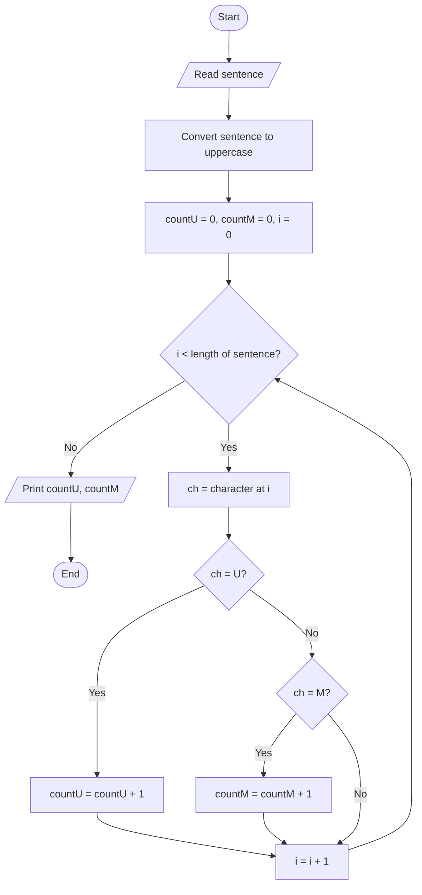

---

## 9. Frequency of a keyword on a web page

| Input | Process | Output |
|---|---|---|
| URL of the web page, keyword | Download the page text; scan the text for the keyword; add 1 to the count each time it is found | frequency |

```text
START
  READ url
  READ keyword
  text = download content of web page at url
  frequency = 0
  position = 0
  WHILE keyword is found in text starting from position
    frequency = frequency + 1
    position = index of match + length of keyword
  ENDWHILE
  PRINT frequency
END
```

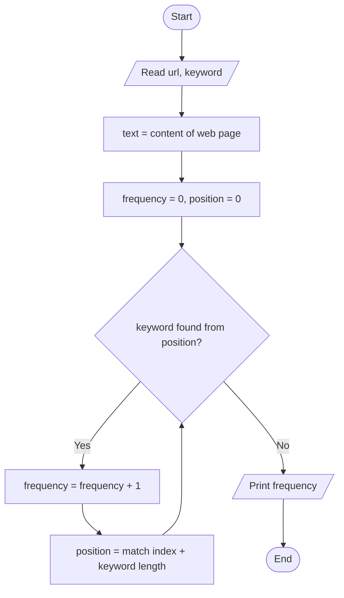

---

## 10. Number of female students in a random list of 100 students

Each student's gender is randomly generated (M or F).

| Input | Process | Output |
|---|---|---|
| None (random list of 100 students, each with a gender) | Go through each student; if gender is female add 1 to the count | femaleCount |

```text
START
  femaleCount = 0
  FOR i = 1 TO 100
    gender = random gender (M or F)
    IF gender = 'F' THEN
      femaleCount = femaleCount + 1
    ENDIF
  ENDFOR
  PRINT femaleCount
END
```

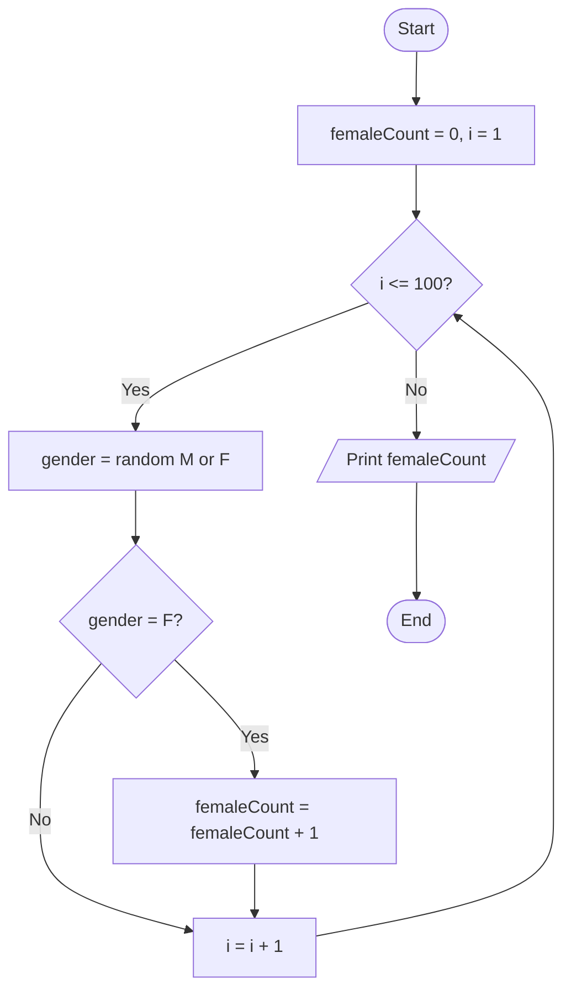

---

## 11. Five random numbers in descending order (sort)

Uses bubble sort.

| Input | Process | Output |
|---|---|---|
| None (5 random numbers generated by computer) | Store numbers in a list; repeatedly compare neighbours and swap if the left one is smaller | The list sorted in descending order |

```text
START
  FOR i = 0 TO 4
    list[i] = random number
  ENDFOR
  FOR pass = 1 TO 4
    FOR j = 0 TO 4 - pass
      IF list[j] < list[j + 1] THEN
        temp = list[j]
        list[j] = list[j + 1]
        list[j + 1] = temp
      ENDIF
    ENDFOR
  ENDFOR
  PRINT list
END
```

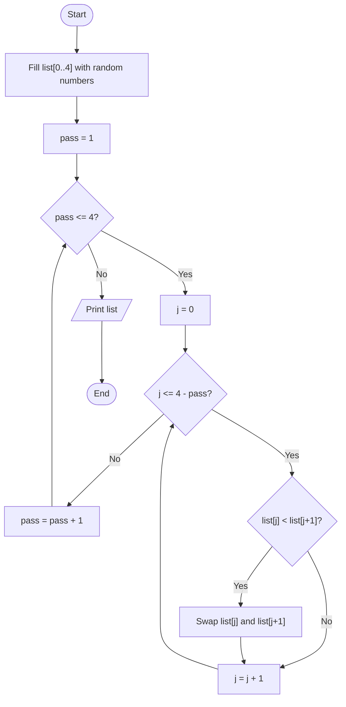

---

## 12. Guess the random number

The computer picks a number from 1 to 100; the user keeps guessing until correct, with a higher/lower hint after each guess.

| Input | Process | Output |
|---|---|---|
| guess (repeated) | Computer generates secret number; compare each guess with it until they match | "Too high" / "Too low" hints, "Correct" and number of attempts |

```text
START
  secret = random number from 1 to 100
  attempts = 0
  REPEAT
    READ guess
    attempts = attempts + 1
    IF guess > secret THEN
      PRINT "Too high"
    ELSE IF guess < secret THEN
      PRINT "Too low"
    ELSE
      PRINT "Correct! Attempts: ", attempts
    ENDIF
  UNTIL guess = secret
END
```

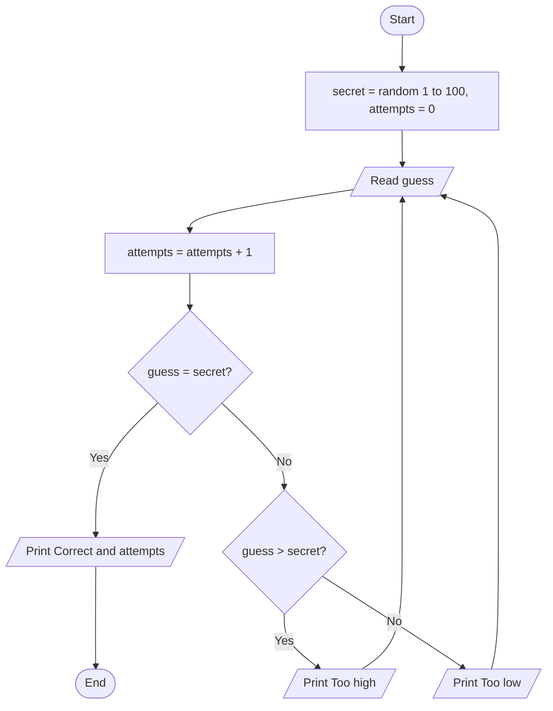
